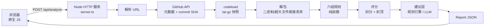

# Repo Lens · Git 仓库接入体检

> 粘贴一个公开 GitHub 仓库地址，几秒内得到一份**可回溯**的接入体检报告：
> 能不能跑、换了机器能不能配、敢不敢公开。
> 每条结论都指向 `文件:行号`，每份报告都绑定在一个具体的 commit 上。

48 小时实战题实现。规格文档在 [`specs/001-repo-health/`](specs/001-repo-health/)，AI 使用记录在 [`AI_USAGE.md`](AI_USAGE.md)。

---

## 快速开始

要求 **Node.js ≥ 22.18**（原生运行 TypeScript，不需要编译、不需要构建）。

```bash
npm run dev        # 等价于 node start.mjs
```

打开 <http://localhost:3000>，粘贴任意公开仓库地址即可。

- **零第三方依赖**：`package.json` 里没有 `dependencies`，`npm install` 是空操作，克隆下来直接能跑。
- **零构建**：没有 bundler、没有 `tsc` 编译步骤，改完代码重启即可。
- **不需要任何配置文件**。

可选环境变量（都不配也能跑）：

| 变量 | 作用 | 不配的后果 |
|---|---|---|
| `GITHUB_TOKEN` | GitHub API 配额从 60 次/小时提升到 5000 次/小时 | 匿名模式，演示 1~2 个仓库够用 |
| `LLM_API_KEY` | 启用 AI 接入建议 | 自动降级为规则引擎生成的建议，页面标注来源 |
| `LLM_BASE_URL` | OpenAI 兼容端点，默认 `https://api.deepseek.com` | — |
| `LLM_MODEL` | 默认 `deepseek-chat` | — |

```bash
# Windows PowerShell
$env:GITHUB_TOKEN="ghp_xxx"; npm run dev
```

---

## 它检查什么

六组规则，共 34 条，全部是确定性判断（正则 + 结构化解析），不依赖模型。

| 组 | 规则 | 典型命中 |
|---|---|---|
| **README** | `RD-01`~`RD-07` | 没有 README、没有安装章节、代码块里没有可执行命令、README 提到的 `npm run xxx` 在 scripts 里不存在 |
| **依赖清单** | `DEP-01`~`DEP-05` | 有源码但没有清单、有 `package.json` 但没 lockfile、Python 引用了第三方包却没有 `requirements.txt`、依赖全部未固定版本 |
| **启动脚本** | `RUN-01`~`RUN-05` | 没有 `start`/`dev` 脚本、Python 找不到入口、**启动脚本引用的文件不存在**（比如 `node dist/index.js` 但 `dist/` 没提交） |
| **Windows 专属脚本** | `WIN-01`~`WIN-03` | 存在 `.bat/.cmd/.ps1/.vbs`、启动方式被 Windows 脚本独占、`.ps1` 要求 `-ExecutionPolicy Bypass` |
| **硬编码路径** | `PATH-01`~`PATH-05` | `C:\Users\...`、`/Users/xxx/`、`/home/xxx/`、绝对路径传进 `readFile()` |
| **密钥与敏感信息** | `SEC-01`~`SEC-10` | 私钥块、`sk-`、`AKID`/`LTAI`、`AKIA`、`Bearer`、`ghp_`、`.env` 入库、`.gitignore` 没忽略 `.env`、配置里的高熵字符串 |

### 误报是怎么压住的

规则检测最大的死法是噪声。这里做了三层抑制：

1. **占位符白名单**（`SEC-09`）：`your_key_here`、`<token>`、`${ENV_VAR}`、`changeme`、`xxx` 等一律降级为「提示」，不参与扣分。
2. **上下文降级**：命中出现在 `docs/`、`examples/`、`tests/`、注释行里时，非密钥类规则降为 `info`。
3. **同类折叠**：同一规则在同一文件最多展开 2 条，其余合并成「另有 N 处」。

> 密钥组**不参与**上下文降级——注释里写的真密钥依然是泄漏。这一条是刻意和上面分开的。

---

## 评分模型

总分由三个子分加权得到，**扣分制**（从 100 往下扣），不是加分制。

| 子分 | 回答的问题 | 权重 |
|---|---|---|
| 可运行性 | clone 下来能跑起来吗 | 35% |
| 可配置性 | 换台机器、换个人能配好吗 | 25% |
| 安全性 | 敢不敢公开 | 40% |

```
total = round(0.35 × 可运行性 + 0.25 × 可配置性 + 0.40 × 安全性)
```

**为什么安全占 40%**：这是三个问题里唯一会造成实际损失的。一个「能跑但把 AK/SK 提交进仓库」的项目，比一个「跑不起来」的项目危险得多。

**封顶规则**：只要出现任意一条 `critical`（私钥 / 真实 `sk-` / `AKID` / `.env` 入库 / Token），总分直接压到 40 分以下。否则会出现「100 分，但密钥已泄露」这种自相矛盾的报告。

**同类封顶**：路径类问题合计最多扣 30 分，安全类 `major` 合计最多扣 45 分。防止规则一多就把分数全扣光、失去区分度。

| 分数 | 等级 | 含义 |
|---|---|---|
| 85–100 | A | 可直接接入，照 README 走 |
| 70–84 | B | 小修即可接入 |
| 50–69 | C | 需要先补齐依赖/脚本/配置 |
| 0–49 | D | 不建议接入 |

---

## 自检结果

两个跑过的样本，数字是实测的：

| 样本 | 结果 | 说明 |
|---|---|---|
| `pallets/flask` | **78 分 · B 级**，10 条结论 | 扣分主要在 README：安装与启动命令都指向文档站，没有可复制执行的命令。`tests/test_apps/.env` 被提交，但内容不含真实凭证，按 minor 处理而不是封顶 |
| 合成「全踩」仓库 | **25 分 · D 级**，封顶 | `.env` 入库、`sk-` 密钥、`C:\` 路径、`/home/` 路径、`.bat`、`-ExecutionPolicy Bypass` 全部命中，13 条规则按预期触发 |

```bash
node tools/smoke.ts https://github.com/pallets/flask   # 真实仓库，打印评分与结论
npm run selfcheck                                       # 合成仓库，断言 13 条规则都触发
```

第二个脚本是「防回归」用的：正则写错、规则被抑制层吃掉、ruleId 改了没同步，都会在这里现形。

---

## 架构



关键取舍：

- **一次 tarball 拉取，不逐文件调 API**。逐文件读 200 个文件要 200 次请求，匿名配额 60 次/小时，一个仓库都分析不完。
- **不 `git clone`**。只读一次快照，不需要历史，也不需要磁盘写入。
- **零第三方依赖**。原计划用 Next.js + React，但安装依赖时镜像源连续超时（缓存卡在 99MB）；改成 Node 原生 HTTP + 原生 JS 之后，克隆即跑，没有任何构建环节。代价是失去组件生态——对一个单页工具可以接受。
- **规则是纯函数**：`(ScanContext) => Finding[]`，无网络、无磁盘、无时间依赖，所以能单测、能复现。
- **AI 不参与评分**。评分只由确定性规则产生，否则同一仓库两次跑出不同分数，报告就不可信了。

---

## 更新跟踪设计

> 题面要求：说明怎么发现更新、怎么避免全量重算、报告如何标注 commit、失败或限流怎么兜底。
> **本期只实现了「报告绑定 commit」和「按 commit 内容寻址的报告缓存」，增量重算是设计，代码未实现**，这里如实说明。

### 1. 怎么发现更新

三条路径，按成本从低到高：

| 方式 | 做法 | 适用 |
|---|---|---|
| **手动** | 报告页「检测更新」按钮 → `GET /repos/{o}/{r}/commits/{branch}?per_page=1` 取最新 SHA，与报告里的 `commitSha` 比对 | 单次使用，零基础设施 |
| **推送** | GitHub App 订阅 `push` 事件，webhook 带上 `after` SHA，直接触发增量分析 | 需要公网回调地址 |
| **轮询** | 定时任务按 `last_checked_at` 排序巡检，用 `If-None-Match` 走 ETag，304 直接跳过 | 无公网入口时的兜底 |

轮询要有配额预算：匿名 60 次/小时，`GITHUB_TOKEN` 5000 次/小时。按每次检查 1 次请求估算，能覆盖的仓库数是硬上限，超出就排队。

### 2. 怎么避免全量重算

核心是**三级缓存 + 文件级复用**：

```
报告缓存   {owner}/{repo}@{commitSha}.json      → SHA 没变则 0 次计算
文件缓存   sha256(文件内容) + rulesetVersion     → 内容没变则复用该文件的 findings
评分       纯聚合，复用 findings 后重算成本 < 1ms
```

流程：

1. `compare` API 拿到 `base...head` 之间的变更文件列表。
2. 只对**变更文件**重新跑规则，其余文件的 findings 从文件缓存直接取。
3. 评分是 findings 的纯函数聚合，所以复用后重算几乎零成本。

这里刻意**没有**用 git blob SHA 做缓存键，而是用文件内容的 `sha256`：算 blob SHA 要手动拼 `"blob {len}\0{content}"`，为了一个缓存键去实现 git 对象格式不划算；内容哈希还顺带支持跨仓库复用。

**什么时候必须全量重算**：
- `rulesetVersion` 变了（规则改了，旧结论作废）——缓存键里带了版本号，天然失效。
- 变更文件超过 300 个（`compare` 的分页上限），增量收益低于复杂度。

### 3. 报告如何标注 commit

每份报告都带：

```json
"source": {
  "owner": "chalk", "repo": "chalk", "ref": "main",
  "commitSha": "a1b2c3d4…（完整 40 位）",
  "shortSha": "a1b2c3d",
  "fetchedAt": "2026-11-26T13:20:11.000Z"
}
```

- UI 顶栏显示短 SHA，页脚显示「报告基于 commit xxx · main」。
- 导出的 JSON 里含完整 SHA，可据此回查代码。
- 历史报告并存、不覆盖，所以能做「上一版 62 分 → 当前 68 分」的对比。
- 缓存键强制包含 SHA，禁止用 `latest` / `main` 这类浮动标识当键（写进了 `constitution.md` 第九条）。

### 4. 失败或限流怎么兜底

| 情况 | 处理 |
|---|---|
| `compare` 404（force push、分支被删） | 回退全量重扫，报告里记一条降级说明 |
| 变更 > 300 文件 | 回退全量重扫 |
| `403` / `429` 限流 | 用 `If-None-Match` 读缓存；304 视为「未变更」直接返回旧报告并标注 `stale`；否则指数退避，把 `X-RateLimit-Reset` 显示给用户 |
| GitHub 超时 | 返回上一次成功的报告，顶部横幅标注「数据来自 {时间}，不是最新」 |
| 快照解压失败 | 回退为只拉关键文件（README / 清单 / 启动脚本），并在 `degradations` 里说明 |

原则：**降级可以，假装成功不行**。任何不是实时全量分析的报告，都必须把降级原因写进 `report.degradations`，让用户看见。

---

## 已知局限

- **只支持 GitHub 公开仓库**。私有仓库要 OAuth，本期不做。
- **只识别 Node 和 Python 生态**。分析 Java/Rust 仓库时依赖项会显示「未识别」，不会假装它「没有依赖」——未知和缺失是两件事。
- **超大仓库**（> 60MB 压缩包 / > 5000 文件）会截断，报告标注 `sampled`。
- **密钥检测是正则 + 熵**，不是真正的凭据验证。它只能告诉你「这里长得像密钥」，不能告诉你「这个密钥还有效」。
- **不执行仓库里的任何代码**，也不安装它的依赖。所有判断都是静态的。

---

## 项目结构

```
server.ts             HTTP 服务：静态文件 + /api/analyze + /api/health
start.mjs             启动器，先检查 Node 版本再加载 server.ts
public/               前端：原生 HTML/CSS/JS，无框架无构建
  index.html
  style.css
  app.js
src/core/             分析内核，不依赖任何 HTTP / DOM
  github.ts           GitHub 元数据 + tarball
  unpack.ts           自带的最小 tar 解析器（无第三方库）
  manifest.ts         依赖清单 / 入口 / 脚本识别
  rules/              六组规则，每条都是纯函数
  score.ts            扣分、封顶、等级
  advice.ts           规则引擎建议 + LLM 适配与降级
tools/smoke.ts        冒烟测试：直接跑内核 + 断言不变量
specs/                规格文档（SDD）
```

`src/core` 不 import 任何 React 或 Next 代码，可以单独跑测试或接 CLI。

---

## SDD（规格驱动开发）说明

这个项目不是「先写代码再补文档」，而是先把不可逆的决策写成可验收的条款，再实现：

| 文件 | 内容 |
|---|---|
| [`constitution.md`](specs/001-repo-health/constitution.md) | 9 条铁律：单命令可运行、密钥不出服务端、同 SHA 幂等、规则必须纯函数… |
| [`spec.md`](specs/001-repo-health/spec.md) | 用户故事 + 验收标准 + 25 条规则目录 + 评分规格 + 降级矩阵 |
| [`plan.md`](specs/001-repo-health/plan.md) | 技术选型、模块边界、缓存设计、测试策略 |
| [`tasks.md`](specs/001-repo-health/tasks.md) | 35 个任务，每个都带验证方式 |
| [`research.md`](specs/001-repo-health/research.md) | 8 条 ADR，含被否掉的方案和理由 |

实现过程中有四处按实际环境修订了规格（npm 代替 pnpm、密钥上下文降级策略、增量更新改为设计、技术栈改为零依赖），修订理由记在 `AI_USAGE.md` 与 spec §9。
